# Customer payment emails

Customer payment and refund confirmations consume `billing.events.v1` in their own `billing-customer-notifications-v1` Kafka group. They run as a component of the laptop Spring application, not as a separately deployed microservice. The same business outbox supports the explicitly selected polling relay or Debezium; the customer consumer does not publish a second financial event.

```mermaid
flowchart LR
    A[Confirmed provider evidence] --> B[PostgreSQL money + outbox commit]
    B --> C[Debezium CDC or selected polling relay]
    C --> D[Kafka billing.events.v1]
    D --> E[Customer notification consumer]
    E --> F[Consumer receipt + email intent commit]
    F --> G[SMTP sender outside SQL]
    G --> H[Configured mail relay over mandatory TLS]
    H --> I[Customer mailbox]
```

Kafka carries the internal event. Spring's `JavaMailSender` and Jakarta Mail speak SMTP to the configured relay, which performs internet delivery. Remote submission requires authentication, mandatory STARTTLS, certificate/hostname verification and bounded timeouts. The local test sink is Mailpit. Personal Gmail is a lab option only; Carrier production should use its approved transactional mail gateway/provider and authenticated sending domain. No SES/SNS or other AWS email service is provisioned by this change; the authorized AWS scope remains Lambda/Step Functions recovery.

The consumer validates schema, canonical outbox content, account/currency and confirmed capture/refund journal evidence. It persists a unique delivery intent and consumer receipt in one short database transaction, then acknowledges Kafka. Sending happens separately. Replays, consumer restart and lost acknowledgements reuse the financial operation key and cannot create a second logical email intent. SMTP acceptance followed by a lost database acknowledgement can still cause duplicate mail; the Message-ID stays the same. SMTP acceptance is not proof of inbox receipt.

Recipient selection uses immutable authenticated payer ownership saved when the payment is created, plus `customer_notification_contacts` for that exact account/user. Only a currently assigned member's enabled, verified contact qualifies. The Kafka payload contains no email address. Finance recipients do not become customer recipients. A refund goes to the payer of the original capture, not the employee requesting or approving it. New attempts use their own authenticated initiating payer. The current API only creates these payments for authorized payer sessions; a future merchant/API creation flow must explicitly establish customer ownership.

Contact revisions and recipient snapshots prevent an old delivery being redirected, including changing an address and later restoring it. Routing/membership are rechecked immediately before SMTP. That check cannot retract a message accepted while a contact is being revoked. A PostgreSQL outbox sequence boundary is saved at feature activation behind the existing writer gate; retained pre-activation events are suppressed. Contact verification/activation times also prevent a newly enabled address receiving an automatic historical blast. No owner/contact is guessed for legacy payments, and suppressed events do not automatically backfill. Query errors roll back and remain unacknowledged; a definitive missing/unverified route creates a suppression record.

The verified contact is a Carrier identity/contact-management integration contract. Entra implementation remains Carrier-owned; this code does not trust an arbitrary browser email field. The non-production demo explicitly uses the user-approved test recipient for fictional buyers. Restarting that demo preserves activation time when the address and enabled state are unchanged.

`CUSTOMER_PAYMENT_RECEIVED` means capture evidence was recorded. It does not promise order fulfilment, available stock or bank settlement: late/unapplied money still requires finance review. `CUSTOMER_REFUND_CONFIRMED` is emitted only for the journaled provider-confirmed refund, with bank processing described separately. Amount and currency are snapshotted in minor units. Visible messages use a public numeric order reference where this is a commerce order, a short explanation and a fixed sign-in link. Internal event types, payment/operation UUIDs and transition versions stay out of the body. Legacy invoice payments without an order do not invent an order reference. The stable random notification Message-ID remains an internal correlation header.

Messages include plain-text and HTML alternatives with no remote images or tracking. Commerce receipts link to `/orders`; a legacy invoice receipt without an order offers a neutral shop link without inventing an order. Internal alerts link to the finance workspace, where existing permissions and independent approval are enforced. The local demonstration uses Mailpit on `http://127.0.0.1:18025` and requires no Gmail authorization. Mailpit never forwards these messages to the internet. It is a mailbox capture tool, not an imitation of Gmail's authentication or delivery service.

The flow audit added database-clock eligibility on new contacts and a monotonic eligibility boundary on updates. Finance routes also have persistent lifecycle revisions, preventing an address change/disable/delete followed by restoration from reviving old pending mail. Capture receipts are suppressed if a known ACH return precedes consumption or the last pre-send check; a return after that check cannot retract email. Test and unauthenticated loopback capture are rejected outside a non-production demo during transport construction, before workers start. After SMTP accepts DATA, an error closing the connection does not schedule an avoidable resend. Actual acceptance followed by an uncertain database acknowledgement still has the documented duplicate window.

Existing finance approval/refund/recovery-review alerts retain their transactional database-trigger path. Customer confirmations use Kafka. Both audiences share the durable SMTP delivery engine with separate route checks and alternating preferred lanes, so a customer backlog does not always take precedence over finance. This shared engine does not make SMTP atomic with PostgreSQL or Kafka.

Production acceptance still includes sender-domain SPF/DKIM/DMARC, relay authentication and bounce/complaint processing, secure contact administration, notification/outbox lag alerts, audited re-drive/retention, and a policy for very old delayed confirmations. This lab does not claim real mailbox delivery until the actual relay and recipient are verified. The financial outbox's reviewed eight-day retention floor covers its configured seven-day Kafka window; restoring/resetting offsets or retaining events longer requires retaining canonical records and deduplication evidence accordingly.

Sources: [Debezium Outbox Event Router](https://debezium.io/documentation/reference/3.6/transformations/outbox-event-router.html), [Spring Kafka database idempotency example](https://docs.spring.io/spring-kafka/reference/tips.html), [Spring mail abstraction and timeouts](https://docs.spring.io/spring-boot/reference/io/email.html).
